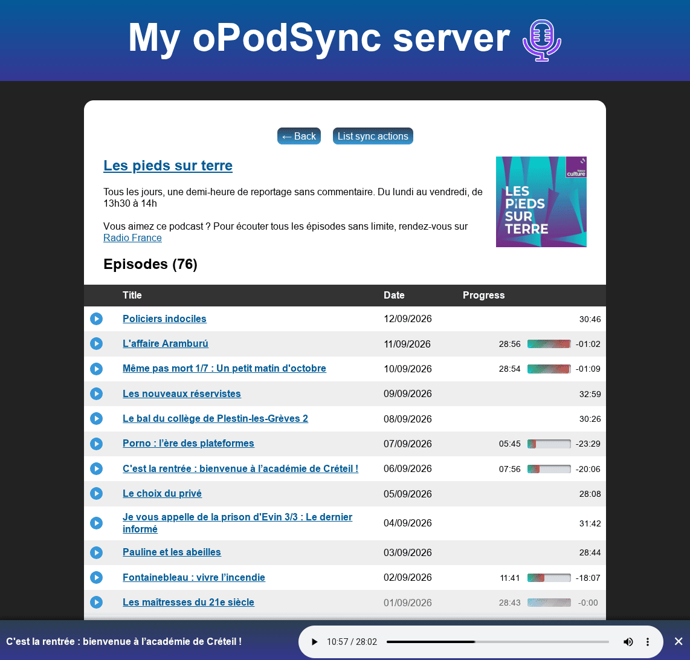
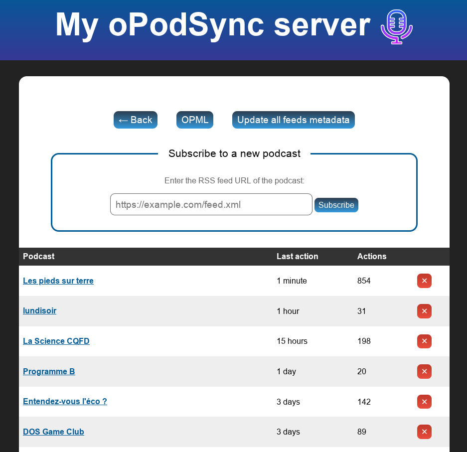
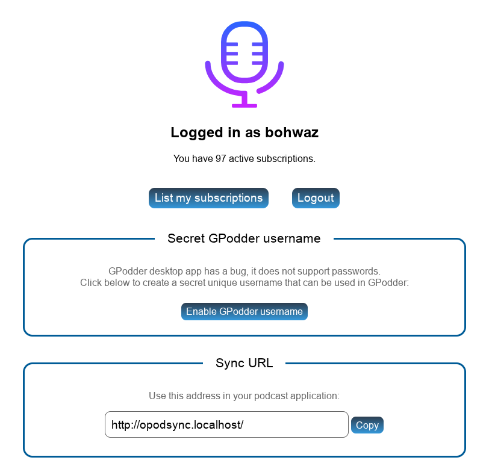

# oPodSync - a minimalist GPodder-compatible server

*(Previously known as Micro GPodder server)*

This is a minimalist podcast synchronization server, for self-hosting your podcast listening / download history.

This allows you to keep track of which episodes have been listened to.

The Docker image uses PHP 8.5 on Alpine 3.24 and SQLite3 with JSON support.
Upstream code requires at least PHP 8.2 syntax; other PHP versions are not tested by this fork.

* Main development happens on Fossil: <https://fossil.kd2.org/opodsync/>
* Github mirror: <https://github.com/kd2org/opodsync> (PR and issues accepted)

## Features

* Compatible with [GPodder](https://gpoddernet.readthedocs.io/en/latest/api/reference/) and NextCloud [gPodder Sync](https://apps.nextcloud.com/apps/gpoddersync) APIs
* Stores history of subscriptions and episodes (plays, downloads, etc.)
* Sync between devices
* Compatible with gPodder desktop client
* Self-registration
* See subscriptions and history on web interface
* Fetch feeds and episodes metadata and store them locally (optional)
* Can be used as an app inside [KaraDAV](https://fossil.kd2.org/karadav/) (alternative WebDAV server with support for NextCloud clients)

## Roadmap

* Support [Podcasting 2.0 GUID](https://podcasting2.org/podcast-namespace/tags/guid)
* Unit tests
* Implement the [Open Podcast API](https://openpodcastapi.org)
* Download, archive and listen to podcasts from the web UI (optional feature)

## Screenshots

  

## Installation

Just copy the files from the `server` directory into a new directory of your webserver, and point a virtual host to this directory (using `DocumentRoot` in Apache).

This should work in most cases. Exceptions are:

* If you are not using Apache, but Caddy, or nginx, make sure to adapt the rules from the `.htaccess` file to your own server. This is untested.
* If you are using Apache, but have set-up this server in a sub-folder of your document root, then you will have to adapt the `.htaccess` to your configuration and set `BASE_URL` correctly in `config.local.php` (see below). This is also untested.

### First account

When installed, the server will allow to create a first account. Just go to the server URL and you will be able to create an account and login.

Account creation remains open by default.

Set `ENABLE_SUBSCRIPTIONS` to `false` to close registration after the first account
(see "Configuration" below). The example configuration explicitly selects this
closed-registration policy.

### Docker

This fork publishes `ghcr.io/adrianba/micro-gpodder-server:latest` after its checks
pass on `main`. A `sha-<full-commit>` tag and OCI source/revision labels identify
each published revision. For deployments, prefer an immutable image digest.

```sh
docker run -d --name opodsync -p 8080:8080 \
  -v opodsync-data:/var/www/server/data \
  -e BASE_URL=https://podcasts.example.org/ -e ERRORS_SHOW=false \
  ghcr.io/adrianba/micro-gpodder-server:latest
```

The image uses PHP's built-in server with two workers. Terminate HTTPS at your
reverse proxy, forward the `Authorization` header, and set the public URL explicitly.
`BASE_URL` must end with `/`. `DATA_ROOT` can override the data directory; mount
persistent storage at the overridden path too. The directory must be writable
for SQLite, logs, configuration, and compiled templates in `cache/templates`.

The example configuration is `/var/www/config.dist.php` inside the image, outside
the persistent volume. Copy it only when creating a new configuration:

```sh
docker exec opodsync sh -c 'test ! -e /var/www/server/data/config.local.php &&
  cp /var/www/config.dist.php /var/www/server/data/config.local.php'
```

If you override `DATA_ROOT`, replace the destination above with that path and
adjust the example's `DATA_ROOT` constant too. Edit the file before restarting.
Configuration constants take precedence over environment
variables, including `BASE_URL`. Do not overwrite an existing configuration.

Other community distributions include:

 * [billznn/opodsync_dckr](https://hub.docker.com/r/billznn/opodsync_dckr): downloads from oPodSync upstream when building the container (not forking) ([Source](https://github.com/mzannoni/opodsync_dckr))
 * [ganeshlab/opodsync](https://hub.docker.com/r/ganeshlab/opodsync): fork with Dockerfile ([Source](https://github.com/ganeshlab/opodsync))

If these images stop being maintained, see [Docker Hub](https://hub.docker.com/search?q=opodsync) to find other community distribution for Docker.

Report issues with this fork's image here, not to upstream.

### Configuration

You can copy the `config.dist.php` to `data/config.local.php`, and edit it to suit your needs.

Configuration files must begin with `<?php` followed by `namespace OPodSync;`.
For example:

```php
<?php
namespace OPodSync;

const BASE_URL = 'https://podcasts.example.org/';
const ENABLE_SUBSCRIPTIONS = false;
const ERRORS_SHOW = false;
const DEBUG_LOG = null;
```

`ERRORS_SHOW` defaults to `true` upstream; explicitly disable it in production.
`DEBUG_LOG` controls API logging and replaces the old `DEBUG` constant. Leave it
disabled unless diagnosing a problem, because API logs may contain credentials.

For a subdirectory installation, set a URL such as
`https://example.org/podcasts/` and serve the application directory at that prefix,
including its PHP scripts and static assets. Preserve that prefix when forwarding
API requests. Merely setting `BASE_URL` does not mount the application at a new
path. Configure `HTTP_SCHEME=https` behind TLS termination for secure session
cookies. CLI feed updates also accept the `BASE_URL` environment variable.

### Upgrading this fork from the 2024 version

Before deployment, identify the actual data volume, configuration, public URL,
proxy prefix/HTTPS settings, and currently deployed image digest. These settings
cannot be inferred from the repository.

1. Stop all writers, including clients, cron jobs, and application containers.
   Make a consistent backup of the complete data/config directory, including any
   SQLite `-wal`, `-shm`, or journal sidecars, and record the old image digest.
1. Test the new image on a copy of that backup, never the only production copy.
   Add `namespace OPodSync;` to old configuration files, rename `DEBUG` to
   `DEBUG_LOG`, and review `config.dist.php`. Global-namespace constants no longer
   configure the application. Configure registration explicitly if it must stay closed.
1. Allow the application to apply migrations from schema `20240428` to `20260911`.
   Verify login, subscriptions, history, public URLs, and client synchronization
   before allowing production writers. Existing web sessions are invalidated.
1. Generate a new secret username in the web UI for each account using gPodder
   desktop and reconfigure those clients. Old password-derived usernames are not
   retained; normal account passwords are preserved.

To roll back, stop writers again and restore **both** the prior image digest and
its matching pre-upgrade data/config backup. Running old code against the migrated
database is not a supported rollback. Writes made after the backup will need
separate recovery. Publishing an image does not deploy or migrate any live instance.

### Development checks

The production image contains no test framework. Client tests use a separate
test target and a pinned, test-only sibling checkout:

```sh
git clone https://github.com/kd2org/kd2fw.git ../kd2fw
git -C ../kd2fw checkout fb6fcd1505683f667250edd86d7787ad4d5a5f40
docker build --target test -t opodsync:test .
docker run --rm --entrypoint sh opodsync:test \
  -c 'find server test -name "*.php" -print0 | xargs -0 -n1 php -l'
docker run --rm -v "$(realpath ../kd2fw):/var/kd2fw:ro" opodsync:test
docker build -t opodsync:verify .
bash test/smoke.sh opodsync:verify
```

The PHP runner creates disposable data directories and owns/cleans up its test
servers. The container smoke check uses disposable volumes and verifies both the
default data path and a `DATA_ROOT` override across restarts. Do not use the legacy
`test.sh` against a deployment; it moves and removes database files.

### Fetching and updating feeds metadata

Version 0.3.0 brings support for fetching metadata for feed subscriptions.

Feeds will only be fetched/updated if an action has been created on the linked subscription since the last fetch.

To update feeds metadata, users can click the **Update all feeds metadata** button in the subscription list, unless you did set `DISABLE_USER_METADATA_UPDATE` to `TRUE`.

You can also just set a crontab to run `index.php` every hour for example:

```
@hourly php /var/www/opodsync/server/index.php
```

This requires to set the `BASE_URL` either in `config.local.php` or in an environment variable.


*Note: episodes titles may not appear in the list of actions, as the media URL may differ between what your podcast apps reports and what the RSS feed providers. This is because some podcast providers will provide a different URL for each user/app, for adding tracking or advertisement.*

## Configuring your podcast client

Just use the domain name where you installed the server, and the login and password you have chosen.

### gPodder (desktop client)

gPodder (the [desktop client](https://gpodder.github.io), not the gpodder.net service) doesn't support any kind of authentication (!!), see this [bug report](https://github.com/gpodder/gpodder/issues/1358) for details.

This means that you have to use a unique secret token as the username.

This token can be created when you log in. Use it as the username in gPodder configuration. Be warned that this username is replacing your password, so it lowers the security of your account.

## APIs

This server supports the following APIs:

* [Authentication](https://gpoddernet.readthedocs.io/en/latest/api/reference/auth.html)
* [Episodes actions](https://gpoddernet.readthedocs.io/en/latest/api/reference/events.html)
* [Subscriptions](https://gpoddernet.readthedocs.io/en/latest/api/reference/subscriptions.html)
* [Device synchronization](https://gpoddernet.readthedocs.io/en/latest/api/reference/sync.html)
* [Devices API](https://gpoddernet.readthedocs.io/en/latest/api/reference/devices.html)

It also supports endpoints defined by the [NextCloud GPodder app](https://github.com/thrillfall/nextcloud-gpodder).

The endpoint `/api/2/updates/(username)/(deviceid).json` (from the Devices API) is not implemented.

### API implementation differences

This server only supports JSON format, except:

* `PUT /subscriptions/(username)/(deviceid).txt`
* `GET /subscriptions/(username)/(deviceid).opml`
* `GET /subscriptions/(username).opml`

Trying to use a different format on other endpoints will result in a 501 error. JSONP is not supported either.

Please also note: the username "current" always points to the currently logged-in user. The deviceid "default" points to the first deviceid found.

## Compatible apps

This server has been tested so far with:

* [AntennaPod](https://github.com/AntennaPod/AntennaPod) 2.6.1 (both GPodder API and NextCloud API) - Android
* [gPodder](https://gpodder.github.io/) 3.10.17 - Debian (requires a specific token, see above!)
* [Kasts](https://invent.kde.org/multimedia/kasts) 21.08 - Linux/Windows/Android
* [PinePods](https://github.com/madeofpendletonwool/PinePods) 0.6.1 - WebServer
* [Music Assistant](https://www.music-assistant.io/music-providers/gpodder/) (according to their documentation)
* [Rhythmbox](https://gnome.pages.gitlab.gnome.org/rhythmbox/) 3.5.0 - Linux

Please report if apps work (or not) with other clients.

It doesn't work with:

* Clementine 1.4.0rc1 - Debian (not possible to choose the server: [bug report](https://github.com/clementine-player/Clementine/issues/7202))

## Other interesting resources

* [Podcast Index](https://podcastindex.org/) to find podcasts and apps
* [Castopod](https://castopod.org/) to share your podcast in the Fediverse
* [Podcasting 2.0](https://podcasting2.org/) to find modern listening apps and update your podcast feeds to the latest features

## License

GNU AGPLv3

## Author

* [BohwaZ](https://bohwaz.net/)

## Fork

Retains Docker/GHCR distribution alongside the complete upstream application.
Pull requests run verification without publishing; main pushes publish only after
verification succeeds.
